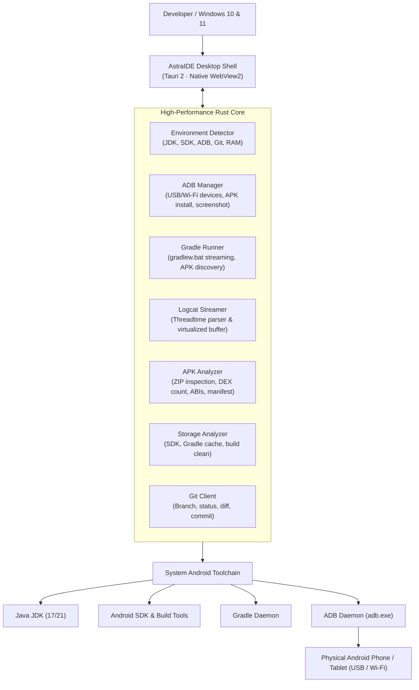

> [!NOTE]
> **[Pre-built Windows Executable Available](https://github.com/jojin1709/AstraIDE/releases/latest):** AstraIDE is distributed as a ready-to-run Windows desktop application. Download `AstraIDE.exe` directly from GitHub Releases — no compiler, Node.js, or Rust toolchain installation required.

# AstraIDE

### Lightweight Android Development Environment for Windows

**AstraIDE** is an ultra-fast, low-memory Android development workstation engineered specifically for Windows developers.

It replaces the multi-gigabyte memory footprint of traditional heavy IDEs with a native Rust core, real-time ADB physical device control, live Logcat streaming, and direct Gradle execution.

<strong>Download AstraIDE</strong>

Instant launch. Low idle RAM (~180–220 MB). Native physical device debugging over USB or Wi-Fi.

---

**Developed by [JOJIN JOHN](https://github.com/jojin1709)** &nbsp;|&nbsp; **[GitHub Releases](https://github.com/jojin1709/AstraIDE/releases)** &nbsp;|&nbsp; **[Report an Issue](https://github.com/jojin1709/AstraIDE/issues)**

---

> [!TIP]
> **What you'll need:** AstraIDE works directly with your existing workstation's Java JDK (17 or 21) and Android SDK. On launch, the built-in diagnostic engine automatically verifies your environment paths and USB-connected devices.

## Table of Contents

- [What is AstraIDE?](#what-is-astraide)
  - [Why AstraIDE Exists](#why-astraide-exists)
  - [The Astra Resource Philosophy](#the-astra-resource-philosophy)
  - [Honest Positioning: What It Replaces & What It Doesn't](#honest-positioning-what-it-replaces--what-it-doesnt)
- [AstraIDE in Action](#astraide-in-action)
- [What You'll Need (Prerequisites)](#what-youll-need-prerequisites)
- [Quick Start: Running AstraIDE](#quick-start-running-astraide)
- [Key Capabilities](#key-capabilities)
- [Architecture & Tech Stack](#architecture--tech-stack)
- [Integrated Tooling](#integrated-tooling)
- [Keyboard Shortcuts](#keyboard-shortcuts)
- [CI/CD & Releases](#cicd--releases)
- [Safety, Privacy, and Offline Guarantee](#safety-privacy-and-offline-guarantee)
- [About the Developer](#about-the-developer)
- [License](#license)
- [Common Questions (FAQ)](#common-questions-faq)

## What is AstraIDE?

AstraIDE is a fast, lightweight alternative Android development environment for Windows. Traditional Android IDEs often consume 3 to 6 gigabytes of RAM at idle, trigger aggressive background indexing, and cause noticeable system lag on developer laptops and budget workstations.

AstraIDE solves this by delivering an efficient, responsive desktop workspace built on Rust and Tauri 2. It integrates code editing, real-time ADB device management, direct Gradle build log streaming, high-throughput Logcat monitoring, APK inspection, and storage diagnostics into a streamlined Windows application.

<strong>Why AstraIDE Exists</strong>

Building Android apps shouldn't require a 32 GB RAM workstation just to edit a layout or deploy an APK to your phone. 

Heavyweight IDEs spend immense CPU cycles and memory on constant background indexing, language servers, and multi-gigabyte caches before you even press "Run". For developers who test on physical Android hardware and want fast, responsive editing without system freeze-ups, AstraIDE provides the essential Android development workflow at a fraction of the hardware cost.

<strong>The Astra Resource Philosophy</strong>

- **Low idle footprint**: Maintains ~180–220 MB RAM consumption while idle.
- **Sub-second startup**: Launches instantly without waiting for indexing daemons.
- **Hardware-friendly**: Leaves your CPU and RAM free for your Gradle builds and emulator/device workloads.
- **Physical device first**: Optimized for fast USB and Wi-Fi debugging on actual Android phones and tablets.

<strong>Honest Positioning: What It Replaces & What It Doesn't</strong>

AstraIDE is **not** a replacement compiler for Google's official Android SDK or the Gradle build tool. Instead, it provides a fast, lightweight graphical environment around the official Android tools already on your machine.

It executes the genuine `gradlew.bat` wrapper, streams live stdout/stderr logs, talks to `adb.exe` directly via Rust, and inspects APK binaries using native ZIP analysis. You get authentic, reproducible Android builds with the full speed of a native Rust desktop application.

## AstraIDE in Action

| Metric / Capability | AstraIDE | Traditional Heavyweight Android IDEs |
| :--- | :--- | :--- |
| **Idle RAM Footprint** | **~180–220 MB** | 3,000–6,000+ MB |
| **Cold Startup Time** | **< 1.0 second** | 20–45+ seconds |
| **App Binary Size** | **~15 MB executable** | 1.5–3.5 GB installation |
| **Physical Device Deployment** | **1-Click ADB USB/Wi-Fi Deploy** | Integrated ADB |
| **Logcat Streaming** | **High-throughput virtualized viewer** | Integrated viewer (can stutter on large streams) |
| **APK Binary Inspector** | **Built-in DEX, ABI & Manifest viewer** | External tool or bundle analyzer |
| **Storage Diagnostics** | **Built-in SDK & Gradle cache cleaner** | Manual filesystem exploration |
| **Telemetry & Tracking** | **Zero Telemetry / 100% Offline** | Analytics and cloud sync services |

## What You'll Need (Prerequisites)

AstraIDE is an orchestration and development environment for the official Android toolchain. To build and run Android applications, your Windows system will need:

1. **Operating System**:
   - Windows 10 (64-bit) or Windows 11 (64-bit)
   - Microsoft Edge WebView2 Runtime (installed by default on modern Windows 10/11)

2. **Java Development Kit (JDK)**:
   - **JDK 17** or **JDK 21** (e.g., [Eclipse Temurin](https://adoptium.net) or Oracle OpenJDK)
   - Ensure `JAVA_HOME` environment variable is configured or JDK is available in your system `PATH`.

3. **Android SDK & Command-Line Tools**:
   - Android SDK Platform Tools (provides `adb.exe`)
   - Android Build Tools and at least one target Android Platform (e.g., API 33 or 34)
   - Ensure `ANDROID_HOME` or `ANDROID_SDK_ROOT` points to your SDK folder.

4. **Physical Android Device or Emulator**:
   - An Android smartphone or tablet connected via USB with **USB Debugging** enabled in *Developer Options*.
   - *(Optional)* Any running Android Virtual Device (AVD).

## Quick Start: Running AstraIDE

> [!WARNING]
> Ensure **USB Debugging** is enabled on your phone and authorize your PC's RSA key fingerprint when prompted on your device screen.

1. **Download the Application**:
   - Go to [AstraIDE Releases](https://github.com/jojin1709/AstraIDE/releases/latest).
   - Download the pre-built `AstraIDE.exe` executable or setup installer.

2. **Launch AstraIDE**:
   - Double-click `AstraIDE.exe`.
   - The integrated **Environment Diagnostics** screen will automatically inspect your machine and verify:
     - Java JDK installation and version
     - Android SDK and `adb.exe` availability
     - Connected Android physical devices & emulators
     - Available system RAM and CPU capabilities

3. **Open or Create a Project**:
   - Click **New Project** to scaffold a clean, buildable Android app (Empty Activity or Basic Activity with Kotlin/Java).
   - Or click **Open Project** to select any existing Android Gradle repository.

4. **Build & Deploy**:
   - Connect your phone via USB.
   - Select your target device from the header dropdown.
   - Click **Run (F5)** to execute `gradlew.bat assembleDebug`, install the generated APK, and stream live Logcat output automatically.

## Key Capabilities

- **Real-Time Environment Diagnostics**: Detects Java JDK, Android SDK paths, ADB daemon status, Git, and active hardware utilization on launch.
- **Physical Device Debugger**: Detects USB and Wi-Fi devices, shows battery status, model names, and connection modes, with one-click screenshot capture.
- **Live Gradle Log Streaming**: Executes `gradlew.bat assembleDebug`, `assembleRelease`, or `clean` with real-time colored terminal output and automatic APK artifact discovery.
- **High-Throughput Logcat Streamer**: Monitors `adb logcat -v threadtime` with instant filtering by log level (`VERBOSE`, `DEBUG`, `INFO`, `WARN`, `ERROR`, `FATAL`), PID, package name, or text query.
- **Built-In APK Analyzer**: Inspects `.apk` archives directly — counts DEX classes, identifies native CPU architectures (`arm64-v8a`, `armeabi-v7a`, `x86_64`), and reads manifest metadata.
- **Android Storage Analyzer**: Breaks down disk space consumed by your Android SDK, Gradle cache (`~/.gradle/caches`), emulator snapshots, and project build folders, with safe cleanup actions.
- **Hardware Resource Monitor**: Displays live system RAM, CPU load, and IDE process memory footprint in real-time.
- **Integrated Terminal**: Built-in PowerShell and Command Prompt shells with your active project path pre-configured.
- **Embedded Git Controls**: Check branch status, review modified files, inspect side-by-side diffs, and create commits without leaving the editor.

## Architecture & Tech Stack

AstraIDE is built with a high-performance Rust backend connected to an ergonomic native WebView2 desktop shell:

## Integrated Tooling

| Component | Technology | Description |
| :--- | :--- | :--- |
| **Core Engine** | Rust 2021 | Native process management, streaming child processes, and system diagnostics. |
| **Desktop Shell** | Tauri 2.x | Lightweight native Windows wrapper utilizing Microsoft Edge WebView2. |
| **Code Editor** | CodeMirror 6 | Fast syntax highlighting for Kotlin, Java, XML, Gradle, JSON, and Markdown. |
| **Process Bridge** | Tauri IPC | Asynchronous, typed Rust-to-UI message passing with sub-millisecond latency. |
| **Project Engine** | Gradle Wrapper | Executes authentic builds using your project's local `gradlew.bat`. |

## Keyboard Shortcuts

| Shortcut | Action |
| :--- | :--- |
| <kbd>Ctrl</kbd> + <kbd>Shift</kbd> + <kbd>P</kbd> | Open Command Palette |
| <kbd>F5</kbd> | Build and Run on selected device |
| <kbd>Ctrl</kbd> + <kbd>S</kbd> | Save active file |
| <kbd>Ctrl</kbd> + <kbd>Shift</kbd> + <kbd>S</kbd> | Save all open files |
| <kbd>Ctrl</kbd> + <kbd>F</kbd> | Find in editor |
| <kbd>Ctrl</kbd> + <kbd>W</kbd> | Close active editor tab |

## CI/CD & Releases

AstraIDE uses automated GitHub Actions workflows to build, test, and package every release:

- **Automated Verification**: Runs full Rust test suites (`cargo test`) and frontend TypeScript compilation (`npm run build`) on every push.
- **Windows Packaging**: Produces standalone Windows 64-bit executables and NSIS installers.
- **GitHub Release Automation**: Pushes versioned binaries and release assets directly to [GitHub Releases](https://github.com/jojin1709/AstraIDE/releases).

## Safety, Privacy, and Offline Guarantee

- **100% Offline by Design**: AstraIDE runs entirely on your local machine. It does not require an active internet connection to edit, build, or deploy to your phone.
- **Zero Cloud Telemetry**: Your source code, keystores, environment paths, and build outputs are never transmitted to external servers.
- **Safe Process Execution**: All executions of `gradlew.bat`, `adb.exe`, and `git.exe` use structured parameter vectors, preventing shell injection vulnerabilities.

## About the Developer

AstraIDE is developed and maintained by **JOJIN JOHN**.

- **Author**: JOJIN JOHN
- **GitHub**: [@jojin1709](https://github.com/jojin1709)
- **Repository**: [https://github.com/jojin1709/AstraIDE](https://github.com/jojin1709/AstraIDE)
- **Issues & Feedback**: [https://github.com/jojin1709/AstraIDE/issues](https://github.com/jojin1709/AstraIDE/issues)

## License

AstraIDE is open-source software licensed under the **[MIT License](LICENSE)**.

You are free to use, modify, distribute, and integrate AstraIDE for personal and commercial projects.

## Common Questions (FAQ)

### Do I need to compile AstraIDE from source to use it?
No. You do not need Rust, Cargo, or Node.js to use AstraIDE. Simply download the pre-compiled `AstraIDE.exe` from [GitHub Releases](https://github.com/jojin1709/AstraIDE/releases/latest) and run it on Windows 10 or 11.

### Can I use AstraIDE without an internet connection?
Yes. Once your Android SDK, Gradle dependencies, and JDK are cached on your machine, AstraIDE operates completely offline. It contains no phone-home telemetry.

### Does AstraIDE support physical Android devices?
Yes! Physical Android hardware is the primary design focus. Connect your phone via USB with USB Debugging enabled, and AstraIDE will immediately detect it, allow one-click APK installation, capture device screenshots, and stream Logcat in real time.

### Can I run Android emulators with AstraIDE?
Yes. If you have an AVD configured in your Android SDK, AstraIDE detects running emulators alongside physical USB devices.

### How does AstraIDE keep memory usage so low?
Unlike IDEs built on heavy JVM runtimes with background AST indexing threads, AstraIDE uses a lean Rust core (~10–20 MB) and Windows' native WebView2 runtime (~150 MB). Memory is kept strictly for your code and active logs, leaving your RAM free for your operating system and Gradle compiler.

---

**Developed with ❤️ by [JOJIN JOHN](https://github.com/jojin1709)**

*AstraIDE — The Lightweight Android Development Environment for Windows*

